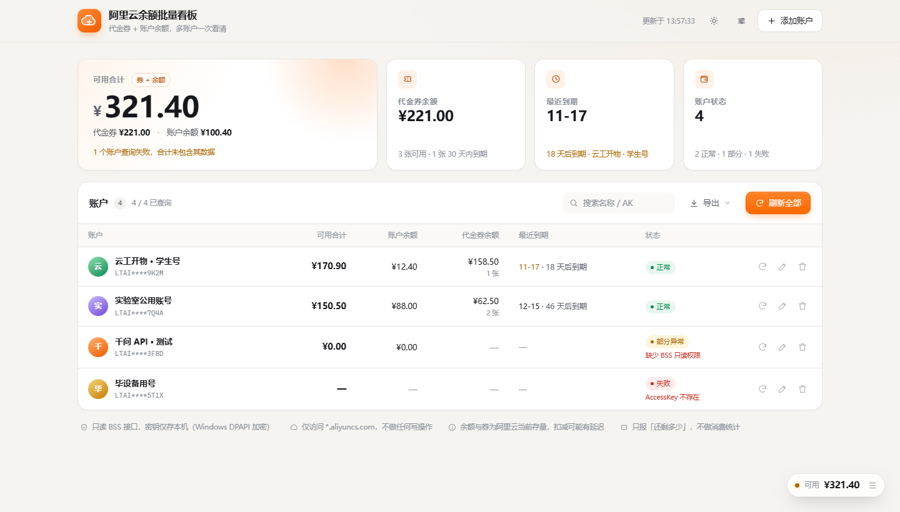

# 阿里云余额批量看板

一次输入多个阿里云 AccessKey，批量查看每个账户的**账户余额**、**代金券余额**与**最近失效时间**，并把「券 + 余额」汇总成一行随时可见的可用额度。

受 [dsh-aliyun-balance](https://github.com/wai549077/dsh-aliyun-balance) 插件启发：保留它「只报还剩多少、不统计消费」的只读思路，把单账户挂件扩展成**多账户批量看板**。



## 适合谁

- 手上不止一个阿里云账号：学生号、实验室公用号、项目备用号……
- 用「云工开物」学生代金券 + 千问平台 API 跑 DSH，想知道券还能花多久
- 想把所有账号的余额和券揉成一个数字，而不是逐个登录控制台

## 功能

- **批量查询**：粘贴多行 `AK,SK`，或导入 `.txt / .csv / .json`，一次性查询全部账户
- **券 + 余额合计**：每账户的「可用合计」= 账户可用额度 + 可用代金券余额
- **券失效时间**：显示最近到期日、剩余天数，并单独提示 30 天内到期的券
- **可拖动悬浮挂件**：右下角一行「可用 ¥xxx」，拖动记忆位置、双击复位、单击刷新、悬停看明细
- **配色跟随主题**：默认跟随系统明暗，也可手动切换浅色 / 深色
- **本地加密存储**：Secret 用 Windows DPAPI 加密，界面与接口只回显 AK 掩码
- **明细与导出**：点账户看券面值 / 已用 / 余额 / 状态 / 失效时间；支持导出 CSV、完整 JSON
- **自动刷新**：默认每 5 分钟，可选关闭 / 1 / 15 / 30 分钟

## 快速开始

要求：Windows 10/11，Python 3.10+（安装时勾选 **Add Python to PATH**）。

1. 双击 **`启动看板.bat`**
2. 浏览器会自动打开 `http://127.0.0.1:17860`（端口被占用时自动顺延，以窗口里的地址为准）
3. 点「添加账户」→ 填 AK / SK → 可先点「测试连接」→ 保存
4. 点「刷新全部」

也可以命令行启动：

```bat
python -m aliyun_balance
python -m aliyun_balance --port 17861 --no-browser
python -m aliyun_balance --data-dir D:\AliyunBoardData
```

关闭启动窗口或按 `Ctrl+C` 即停止服务。数据只在本机，不需要联网部署。

## 准备只读 AK/SK

1. 阿里云控制台 → **RAM 访问控制** → 用户 → 创建用户
2. 勾选「使用永久 AccessKey 访问」，**不要**勾选控制台登录
3. 授予系统策略 **`AliyunBSSReadOnlyAccess`**（只读账单 / 余额 / 代金券）
4. 为该用户创建 AccessKey，把 **AccessKey ID / Secret** 填进看板

> 请使用**只读 RAM 子账号**，不要使用主账号 AccessKey。Secret 只在创建时显示一次。
>
> 本工具只调用两个只读接口：`QueryAccountBalance`（账户余额）和 `QueryCashCoupons`（现金代金券），不做任何写操作，也不统计消费。

## 批量输入格式

「添加账户 → 批量粘贴」支持以下写法，每行一个账户：

```text
# 名称,AK,SK（推荐）
云工开物学生号,LTAI5tXxxxxxxxxxxxxxxx,Secretxxxxxxxxxxxxxxxx
实验室公用号,LTAI5tYyyyyyyyyyyyyyyy,Secretyyyyyyyyyyyyyyyy

# 只有 AK,SK 时自动命名
LTAI5tZzzzzzzzzzzzzzzz,Secretzzzzzzzzzzzzzzzz

# AK,SK,备注
LTAI5tAaaaaaaaaaaaaaaa,Secretaaaaaaaaaaaaaaaa,毕设备用号

# 名称,AK,SK,Endpoint（国际站）
新加坡账号,LTAI5tBbbbbbbbbbbbbbbb,Secretbbbbbbbbbbbbbbbb,business.ap-southeast-1.aliyuncs.com
```

- 逗号、中文逗号、制表符、空格都可以作为分隔符
- 以 `#` 开头的行会被忽略
- 也可以粘贴 JSON 数组：

```json
[
  { "name": "学生号", "ak": "LTAI5t...", "sk": "Secret...", "endpoint": "business.aliyuncs.com" }
]
```

- 「从文件导入」读取 `.txt / .csv / .json` 后填入输入框，确认预览数量再添加
- 重复的 AK 会更新原账户（可用于轮换 Secret），不会产生重复行

## 数字怎么读

| 指标 | 含义 |
|---|---|
| 可用合计 | **账户余额 + 代金券余额**，即当前真正还能花的钱 |
| 账户余额 | 阿里云 `AvailableAmount`，包含现金与信控额度，**不含代金券** |
| 代金券余额 | 状态为可用的现金券 `Balance` 之和 |
| 最近到期 | 所有可用券中最早的 `ExpiryTime` |
| 30 天内到期 | 剩余有效期 ≤ 30 天的可用券数量与金额 |

- 余额和券是阿里云 BSS 的**当前存量**，不是账单；扣减可能有延迟，不适合反推单次消费
- 同一账户多张券时，明细里按「可用优先、到期时间升序」排列
- 国际站账户可能返回 USD 等币种，汇总会按币种分组，不会把不同币种直接相加

## 悬浮挂件

右下角那一行就是挂件：

| 操作 | 效果 |
|---|---|
| 拖动 | 移动到任意位置，刷新页面后仍在原处 |
| 双击 | 复位到右下角 |
| 单击 | 立即刷新全部账户 |
| 悬停 | 展开券 / 余额 / 最近到期 / 正常账户数明细 |
| 点 ☰ | 打开设置 |

可在「设置 → 悬浮挂件」中关闭；挂件和主界面共享同一套主题色。

## 数据与安全

- 账户保存在 `data/accounts.json`，**Secret 使用 Windows DPAPI 加密**（绑定当前 Windows 用户与机器）
- AK 以掩码显示（如 `LTAI****9K2M`）；任何接口都不会回显 SK，更新时 SK 留空表示保持原值
- 服务只监听 `127.0.0.1`，并校验 `Host` / `Origin`，写操作要求自定义请求头，降低 DNS rebinding 与跨站请求风险
- Endpoint 只允许 `*.aliyuncs.com`，网络出口不会超出阿里云
- 页面使用严格 CSP，不加载任何外部脚本、字体或统计代码
- 如果系统无法使用 DPAPI（例如在非 Windows 上运行），Secret 会退回 base64 混淆，界面会显示警告——这种环境下不建议保存重要凭据

> **备份提示**：直接复制整个目录即可。`accounts.json` 里的 Secret 只能在**同一台机器、同一个 Windows 用户**下解密；换机器需要重新输入 SK。

清空数据：在设置里点「清空所有账户」，或删除 `data/accounts.json`。

## 常见错误

| 错误码 | 含义 / 处理 |
|---|---|
| `InvalidAccessKeyId.NotFound` | AK 不存在或复制不完整，重新复制 AccessKey ID |
| `SignatureDoesNotMatch` | SK 不正确或已轮换，重新输入 Secret |
| `Forbidden.RAM` / `NoPermission` | 该 AK 缺少 BSS 只读权限，给 RAM 用户挂 `AliyunBSSReadOnlyAccess` |
| `Throttling` | 请求过于频繁，等一会儿再刷新（批量查询会并发，但会限制在 6 个并发内） |
| `InvalidTimeStamp` | 本机时间偏差过大，校准系统时间 |
| `NetworkError` | 网络不可达；检查代理、防火墙或公司网络策略 |

「测试连接」会把阿里云返回的原始错误码一并显示，方便排查。

## 工作原理

```text
浏览器（本地页面）
   │  JSON over 127.0.0.1
   ▼
Python 本地服务（仅标准库）
   │  ACS3-HMAC-SHA256 签名
   ▼
阿里云 BSS OpenAPI 2017-12-14
   ├─ QueryAccountBalance  → AvailableAmount / AvailableCashAmount / CreditAmount
   └─ QueryCashCoupons     → Data.CashCoupon[]（面值 / 余额 / 状态 / 失效时间）
```

- 签名使用阿里云 ACS3-HMAC-SHA256（v3），Action / Version 放在 `x-acs-*` 请求头
- `QueryCashCoupons` 无分页；列表为空时会用 `EffectiveOrNot=true/false` 各补查一次并合并
- 金额在服务端用 `Decimal` 精确到分，前端只做展示，避免浮点误差
- 两个接口按账户并发查询，单账户内余额与券也并发

## 开发与测试

无第三方运行时依赖，只用 Python 标准库。

```bat
python -m unittest discover -s tests -v
```

28 个测试覆盖：

- ACS3 签名的黄金向量（与阿里云服务端返回的 CanonicalRequest 哈希逐字一致）
- 金额 / 时间归一化、券排序与汇总
- DPAPI 加密存储、AK 去重更新、损坏文件恢复
- HTTP API：增删改查、批量查询、CSRF、Host 校验、密钥不回显

目录结构：

```text
aliyun_balance/
  bss.py        # ACS3 签名、BSS 调用、响应归一化、汇总
  store.py      # 本地账户存储 + Windows DPAPI
  server.py     # 127.0.0.1 HTTP 服务与 JSON API
  __main__.py   # 启动、端口选择、打开浏览器
web/
  index.html    # 页面结构
  app.js        # 状态、渲染、挂件、导入导出
  style.css     # 主题令牌与响应式样式
tests/          # unittest
data/           # 运行时生成（账户与日志，已加入 .gitignore）
启动看板.bat
```

开发期截图脚本在 `_dev/`（依赖 Playwright，可选，不参与运行）。

## 已知限制

- 只读展示，**不做消费统计 / 预算告警**；想知道花了多少请用账单或 dsh-cost-meter 之类的工具
- 阿里云余额与券的扣减有延迟，刷新时间不代表消费时间
- 仅支持现金代金券（`QueryCashCoupons`），不支持所有营销券类型
- 挂件位置与主题偏好保存在浏览器 localStorage；换浏览器需要重新设置
- 主界面为桌面优先；窄屏会切换成账户卡片布局

## 致谢与许可

思路与「只读 BSS 存量」的产品方向来自 [wai549077/dsh-aliyun-balance](https://github.com/wai549077/dsh-aliyun-balance)（MIT）。本项目是独立实现的多账户版本，未复用其插件运行时。

本项目使用 MIT License，见 [LICENSE](LICENSE)。
